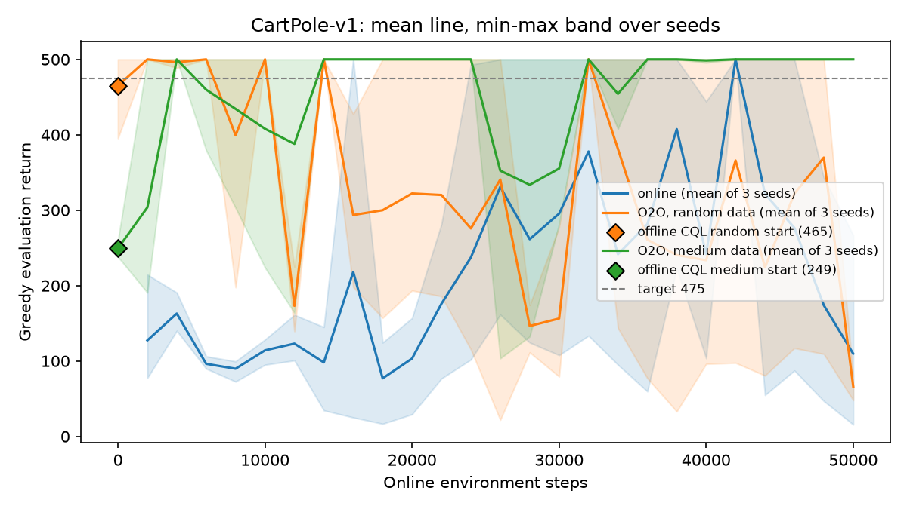
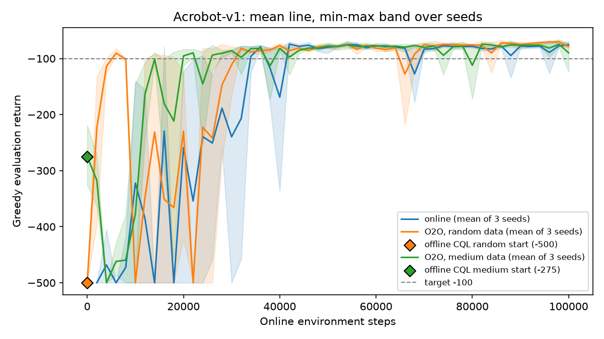
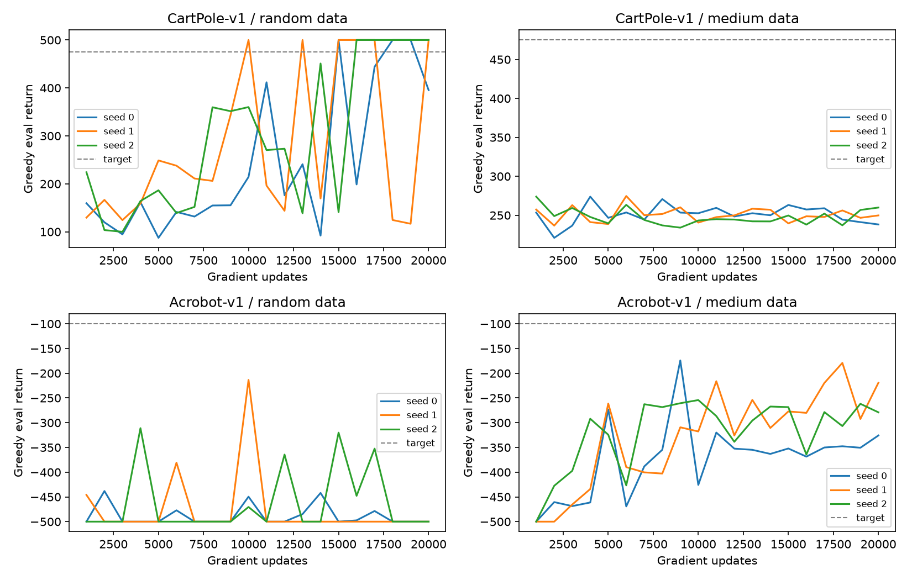

# Results overview
*Generated by `python summarise.py` on 2026-11-07. Do not edit by hand; rerun the script.*

## Datasets

| Env | Dataset | Episodes | Return (mean ± SD) | Terminated | Truncated | Epsilon | Agent progress | Dataset progress |
|---|---|---|---|---|---|---|---|---|
| CartPole-v1 | random | 897 | 22.3 ± 11.6 | 897 | 0 | 1 | - | - |
| CartPole-v1 | medium | 101 | 196.1 ± 84.9 | 101 | 0 | 0.05 | 0.48 | 0.38 |
| Acrobot-v1 | random | 40 | -496.3 ± 23.3 | 1 | 39 | 1 | - | - |
| Acrobot-v1 | medium | 102 | -194.3 ± 71.1 | 101 | 1 | 0.05 | 0.51 | 0.76 |

*Note: `terminated` means different things. In CartPole it means the pole fell (failure); in Acrobot it means the goal was reached (success). Truncated = hit the time limit.*

## How to read this

- **Return** = total reward in one game. Higher is better in both environments.
  CartPole: number of steps the pole stays up (max 500). Acrobot: minus the number of steps taken
  (so closer to 0 is better; -500 means it never reached the goal).
- **Targets** (used for "steps to target"): CartPole **475**, Acrobot **-100**.
- **Q sanity limits** (mean Q of the actions taken): CartPole must be **<= 100** (reward +1 per step,
  gamma 0.99, so 1/(1-0.99) = 100); Acrobot must be **<= 0** (every step costs -1). A mean Q above its limit
  means the network is overestimating.
- **Which number to trust most:** the *mean of the last 5 evals* (smooths single lucky or unlucky tests),
  then the *final return* (20 episodes at the very end). *Best eval* is optimistic: it is the highest of many
  noisy tests, and so is "steps to target" (the first test that crossed the line may be a spike).
- **Steps to target** counts ONLINE environment steps only. Offline runs use no online steps; their targets
  are counted in gradient updates, which are not comparable with game steps.
- **± values** are the sample SD across seeds. "(k/n reached)" means only k of n seeds reached the target, and
  the mean is over those k.
- **O2O** = offline-to-online: start from the offline CQL weights and keep learning by playing.
  Its eval at online step 0 is the offline agent before any play.

## CartPole-v1 (target 475)

| Configuration | Online steps used | Steps to target | Episodes to target | Final return (20 eps) | Mean of last 5 evals | Best eval | Last mean Q | Seeds |
|---|---|---|---|---|---|---|---|---|
| online | 50000 ± 0 | 28000 ± 10583 | 423 ± 190 | 111.7 ± 136.3 | 276.3 ± 89.7 | 500.0 ± 0.0 | 82.0 ± 7.1 | 3 |
| offline CQL, random data | 0 | n/a (gradient updates) | n/a | 459.4 ± 70.3 | 418.6 ± 76.5 | 500.0 ± 0.0 | 30.1 ± 1.3 | 3 |
| offline CQL, medium data | 0 | n/a (gradient updates) | n/a | 246.4 ± 16.5 | 248.9 ± 0.9 | 274.2 ± 0.5 | 61.3 ± 1.2 | 3 |
| O2O, random data | 50000 ± 0 | 667 ± 1155 | 1 ± 2 | 69.5 ± 13.5 | 269.6 ± 155.6 | 500.0 ± 0.0 | 110.1 ± 17.9 | 3 |
| O2O, medium data | 50000 ± 0 | 3333 ± 1155 | 44 ± 30 | 500.0 ± 0.0 | 500.0 ± 0.0 | 500.0 ± 0.0 | 99.7 ± 5.5 | 3 |

### Fine-tuning dip (O2O): eval at online step 0 vs the lowest in the first 6,000 steps

| Configuration | Seed | Eval at step 0 | Lowest in first 6,000 steps | At step | Change |
|---|---|---|---|---|---|
| O2O, random data | s0 | 395.4 | 500.0 | 2,000 | no dip |
| O2O, random data | s1 | 500.0 | 488.6 | 4,000 | -11.4 |
| O2O, random data | s2 | 500.0 | 500.0 | 2,000 | no dip |
| O2O, medium data | s0 | 238.2 | 190.7 | 2,000 | -47.5 |
| O2O, medium data | s1 | 249.8 | 220.3 | 2,000 | -29.5 |
| O2O, medium data | s2 | 259.9 | 379.3 | 6,000 | no dip |

## Acrobot-v1 (target -100)

| Configuration | Online steps used | Steps to target | Episodes to target | Final return (20 eps) | Mean of last 5 evals | Best eval | Last mean Q | Seeds |
|---|---|---|---|---|---|---|---|---|
| online | 100000 ± 0 | 27333 ± 10263 | 173 ± 91 | -79.5 ± 3.0 | -79.6 ± 5.9 | -68.5 ± 0.7 | -30.8 ± 1.4 | 3 |
| offline CQL, random data | 0 | n/a (gradient updates) | n/a | -488.0 ± 20.8 | -485.1 ± 21.8 | -320.8 ± 112.7 | -52.7 ± 0.4 | 3 |
| offline CQL, medium data | 0 | n/a (gradient updates) | n/a | -250.0 ± 71.0 | -294.9 ± 55.3 | -202.5 ± 44.9 | -50.8 ± 0.7 | 3 |
| O2O, random data | 100000 ± 0 | 6000 ± 0 | 40 ± 7 | -77.7 ± 2.0 | -72.8 ± 0.6 | -69.2 ± 2.0 | -33.3 ± 2.1 | 3 |
| O2O, medium data | 100000 ± 0 | 17333 ± 3055 | 95 ± 15 | -96.0 ± 41.4 | -79.6 ± 10.6 | -68.9 ± 2.5 | -32.3 ± 0.6 | 3 |

### Fine-tuning dip (O2O): eval at online step 0 vs the lowest in the first 6,000 steps

| Configuration | Seed | Eval at step 0 | Lowest in first 6,000 steps | At step | Change |
|---|---|---|---|---|---|
| O2O, random data | s0 | -500.0 | -142.5 | 2,000 | no dip |
| O2O, random data | s1 | -500.0 | -396.2 | 2,000 | no dip |
| O2O, random data | s2 | -500.0 | -131.9 | 2,000 | no dip |
| O2O, medium data | s0 | -325.8 | -500.0 | 4,000 | -174.2 |
| O2O, medium data | s1 | -219.2 | -500.0 | 4,000 | -280.8 |
| O2O, medium data | s2 | -279.0 | -500.0 | 4,000 | -221.0 |

## Offline CQL curves (x = gradient updates, one line per seed)

## Settings and seeds used

- **CartPole-v1**: online budget 50,000 steps, eval every 2,000 online steps (10 greedy episodes; 1,000 updates offline), offline 20,000 updates at CQL alpha 1, dataset 20,000 transitions, O2O epsilon 0.1 -> 0.04 over 8,000 steps with online CQL alpha 0. Seeds found: online: [0, 1, 2]; offline CQL, random data: [0, 1, 2]; offline CQL, medium data: [0, 1, 2]; O2O, random data: [0, 1, 2]; O2O, medium data: [0, 1, 2].
- **Acrobot-v1**: online budget 100,000 steps, eval every 2,000 online steps (10 greedy episodes; 1,000 updates offline), offline 20,000 updates at CQL alpha 1, dataset 20,000 transitions, O2O epsilon 0.1 -> 0.1 over 12,000 steps with online CQL alpha 0. Seeds found: online: [0, 1, 2]; offline CQL, random data: [0, 1, 2]; offline CQL, medium data: [0, 1, 2]; O2O, random data: [0, 1, 2]; O2O, medium data: [0, 1, 2].
- Same dataset (seed 0) for every training seed. Eval every N steps is coarse (a spike between two evals is invisible). Results reproduce exactly on the same machine, but may differ on another machine.

## Folders

- `results/online/<env>/s<seed>/` : pure online DQN run (eval.csv, episodes.csv, summary.json, model.pt)
- `results/offline/<env>/<dataset>/s<seed>/` : offline CQL run from the random or medium dataset (eval.csv, summary.json, model.pt)
- `results/o2o/<env>/<dataset>/s<seed>/` : offline-to-online run, started from the matching offline seed (eval.csv, episodes.csv, summary.json, model.pt)
- `results/figures/` : every .png (generated by summarise.py, plot.py)
- `results/archive/` : old or superseded runs, kept but not used in any table
- `logs/` : console output of the batch runs
- `data/` : the offline datasets (.npz + .json with the dataset's average return)
